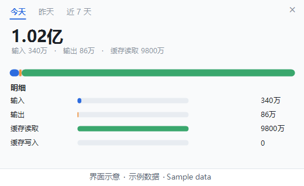
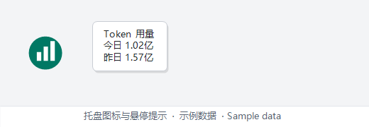
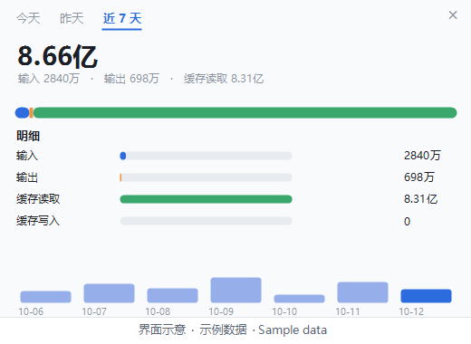

# LLM Token Counter (DSH)

**English** ｜ [简体中文](README.zh-CN.md)

DeepSeek Harness shows you the usage of the current session, but not **how much you burned today, or how much yesterday**.
This little tool turns that into a single number in the Windows system tray.



**Illustration only: the numbers in the screenshot are sample data, not anyone's actual usage.**

**Who it's for**: anyone working with DeepSeek Harness who wants to know how many tokens today and yesterday used.

**Why keep it in the tray**

- **Entirely local and read-only**: it reads the usage cache DSH keeps on this machine. No network, and nothing in DSH is touched.
- **No admin rights, no runtime**: double-click the launcher and it runs.
- **One number is enough**: the tray shows today's total, and hovering gives today and yesterday.
- **Broken down**: input, output, cache reads and cache writes are listed separately, so the cache-read figure does not overwhelm you.

Version 1.0 ｜ MIT license (see [LICENSE](LICENSE)) ｜ A personal tool; no promise it fits your setup

---

## What it looks like

- **Icon**: a greenish circle showing today's total. The number inside is in units of 10,000 ("万"),
  capped at 9999 (i.e. ninety-nine million and change); anything larger stays at 9999.
  
- **Hovering** shows three lines: the title, today's usage, and yesterday's. The unit adapts:
  10,000s when small, 100 millions ("亿") when large.
  

- **Right-click menu**:

| Item | What it does |
| --- | --- |
| Details | Pops up a panel from the bottom-right; clicking elsewhere dismisses it |
| Refresh now | Reads again immediately (no popup) |
| Open folder | Opens the folder the tool lives in |
| Exit | Quits |

A left click on the tray icon also opens the details panel; clicking again while it is already open does nothing
(it will not flash and pop again). To dismiss it, click outside the panel or hit the × in its top-right corner.
The right-click menu offers the same actions.

### The details panel

It is meant to be read as a picture, not as text:

- Three tabs at the top switch between **Today / Yesterday / Last 7 days**; Today is the default.
- The big number in the middle is the total for that period; the small line under it splits it into input, output and cache reads.
- Below that, a three-part colour bar: input blue, output orange, cache reads green, drawn in proportion.
- Then the **breakdown** in four rows: input / output / cache reads / cache writes, each with a bar and the number on the right.
- At the bottom, **Last 7 days** draws one bar per day, its height being that day's total, with today in a darker shade.
  Only the "Last 7 days" tab shows this strip; hovering a bar highlights it and shows that day's date and number.



## Requirements

- Windows 10 or 11 (PowerShell 5.1 and .NET Framework are built in, so there is no runtime to install)
- DeepSeek Harness (DSH) installed and used at least once — this reads the usage data DSH keeps on your machine
- No administrator rights, no change to the PowerShell execution policy, no internet access

If DSH is not installed: the icon still appears, but the number stays at 0.

## Installation

1. **Unblock the files before running them** — do not skip this.
   - Do not run it straight from the zip viewer; that extracts to a temp folder and every path gets mangled.
     Extract the whole folder to disk first.
   - Files downloaded from the internet carry a "from the internet" mark. Without unblocking, double-clicking
     triggers "Windows protected your PC". Fix: select all files in the folder → right-click → Properties →
     tick *Unblock* at the bottom → OK. Do this for every file; it does not matter which is `.vbs` and which is `.ps1`.
   - If there is no *Unblock* checkbox and you are still blocked: click *More info* in the dialog, then *Run anyway*.
   - Windows 11 hides extensions by default, so you will see `start-token-counter` instead of
     `start-token-counter.vbs`. To show them: Explorer → View → Show → File name extensions.

2. Put the whole `dsh-token-counter` folder somewhere permanent, for example `D:\tools\dsh-token-counter`.
   The path does not matter — spaces and non-ASCII characters are fine. **But it must be writable**: do not put it under
   `Program Files` or anywhere that needs administrator rights, because the tool writes its data and logs inside its own folder.

   Try to settle on a location. Moving the folder later still works, but the autostart shortcut from step 5 breaks
   (the symptom is that no icon appears after a reboot); delete that shortcut and recreate it.

3. Double-click the launcher (`start-token-counter`). The icon appearing in the tray means it is installed; give it a second or two.

4. No icon, or you cannot find it:
   - Click the little up arrow (∧) at the bottom-right of the taskbar: that is the hidden-icons panel, and it is usually in there.
   - To keep it visible: Settings → Personalization → Taskbar → Other system tray icons, and turn it on.
   - **Note**: Windows remembers tray items per program, and both tools run under PowerShell, so it shows up in that list
     as "Windows PowerShell", not as this tool's name. Recognise it by its look: a greenish circle with a number.

5. To start it automatically at logon, pick either way:

   **Way A**: right-click the launcher → Send to → Desktop (create shortcut); press `Win + R`, type `shell:startup`,
   press Enter, and paste the shortcut into that Startup folder.

   **Way B**: in the Startup folder, right-click → New → Shortcut, and use this as the location
   (replace the path with yours; keep the quotes, especially if the path has spaces):

   ```
   wscript.exe "D:\tools\dsh-token-counter\start-token-counter.vbs"
   ```

   **Autostart is recommended** — see "Known limitations" below.

### Desktop icon

A shortcut to a script shows the generic Windows script icon by default, and all three tools look identical.
To make it match the tray dot: right-click the shortcut → Properties → Change Icon → pick `icon.ico` in this folder.

## Usage

- Leave it alone; it reads once a minute.
- For details, right-click the icon and choose *Details*.
- Only one instance runs at a time: double-clicking again makes the extra one exit by itself.
- It uses roughly 100–150 MB of memory.

## Under the hood

- **It only reads the session usage cache DSH keeps locally** (uncompressed JSON), once a minute; it does not decompress the raw session records.
- **Each session gets a baseline and deltas are accumulated**; if a cumulative value shrinks the session was rebuilt, so only the baseline is updated and nothing is added to the day.
- **The first run takes the current values as the baseline**, otherwise the whole historical total would land on today.
- **State is written to a temp file and then swapped in**; if it cannot be read, the remains are kept, a line goes into the log,
  and the previous backup is restored. It sits at roughly 100–150 MB of memory.

## What the numbers mean

- **Total = uncached input + output + cache reads.** The number on the tray icon is exactly the "total" row in the panel.
- The five rows in the panel:

  | Row | Meaning |
  | --- | --- |
  | Input | What was actually sent to the model in this session and was not served from cache |
  | Output | What the model generated |
  | Cache reads | Input that hit the cache: a large count, but a much cheaper unit price |
  | Cache writes | The part written into the cache. It has always been 0 on DeepSeek's side, so it is not in the total |
  | Total | The first three added together |

- Cache reads are usually far larger than the other rows, but far cheaper per unit, so do not judge by the total alone.
- Numbers are rounded: one decimal in units of 10,000, two decimals in units of 100 million.
- "Today" switches at your machine's midnight.
- This is local DSH usage and **is not your DeepSeek bill**: the backend has off-peak discounts, prices change,
  and usage of the same account from other clients is not here. So it reports tokens only and never converts to money.
  Use it for trends and relative volume, not as a statement.
- The data source is the session usage cache DSH keeps locally. It is read-only; nothing in DSH is modified.
  To verify it yourself: open the `.dsh\storages\session_projcache\sessions` folder in your user directory;
  each JSON file there is one usage stream. If that folder does not exist, DSH either is not installed or has never run.

## What you will see after a fresh install

Today starts at zero and "yesterday" only gets a number on the second day, so at first the number is small or 0.

To tell whether it is actually reading DSH data: open *Details* and watch whether "cache reads" climbs within that minute.
While you are using DSH it should climb; if it is nailed in place, nothing is being read — check that the `.dsh` folder above exists.

## Known limitations

- Day-by-day accounting starts from the moment this program first runs. Usage while it is not running is missed.
  That is why **autostart is recommended** (step 5): started with the machine, it misses nothing.
  Running it by hand still works, but the usage between boot and the moment you start it is lost.
- It only counts DSH on this machine. Switching accounts, other clients and the web version are not included.
- It does not read while the machine is suspended, but DSH is normally not running then either, so the effect is small.

## Reset

Right-click → Exit, delete `state.json`, start again.

Note: after that it takes the current cumulative values as its new baseline, i.e. it starts counting from that moment
and all previous days go to zero.

## Troubleshooting

**The icon is gone**
Click the ∧ arrow on the taskbar to check the hidden panel; then check Settings → Personalization → Taskbar →
Other system tray icons (it appears there as Windows PowerShell).

**The number is always 0, or never moves**
First confirm DSH is installed and has been used (check whether the `.dsh\storages\session_projcache\sessions` folder exists).
Then check whether "cache reads" in the panel climbs. If neither moves, look at the log.

**The icon stopped appearing at logon although it used to work**
Most likely the folder was moved and the autostart shortcut broke. Delete it and recreate it.

**Double-clicking the launcher does nothing**
Do step 1 (unblocking) first, then check whether antivirus blocked the `.vbs`.
Run it by hand: open PowerShell from the Start menu, paste the line below and press Enter, and see whether anything red appears
(the execution policy has to be passed explicitly; right-clicking → "Run with PowerShell" gets blocked by policy):

```
powershell -NoProfile -ExecutionPolicy Bypass -File "D:\tools\dsh-token-counter\token-counter.ps1" -Once
```

## Reading the log

`token-counter.log` sits in the tool folder; double-clicking opens it in Notepad.
It is small (tens of KB at most), is recreated if you delete it, and only appears after it has run for a moment.

In normal operation it has little more than a few `tray started` lines. If anything else appears, keep the log.
If the log is empty and something is still wrong, work through the troubleshooting section above.

## Uninstalling completely

1. Right-click the tray icon → Exit.
   Do not skip this. Deleting the folder while it runs technically works, but the process keeps going in the background,
   fails to find its files every few seconds, and you would have to kill it from Task Manager anyway.
2. Confirm it is really gone: press `Ctrl+Shift+Esc` for Task Manager, switch to the *Details* tab, right-click a column header →
   Select columns → tick *Command line*, find `powershell.exe`, and check whether `token-counter.ps1` still appears in a command line.
   If the folder is already deleted but the process is still there: end that `powershell.exe` in Task Manager, or reboot.
3. Delete the whole `dsh-token-counter` folder. Your usage data `state.json` is inside it and goes with it.
4. Delete the Startup shortcut if you created one. `Win + R`, type `shell:startup`, press Enter.
5. If you toggled it in "Other system tray icons", a record stays there (it records the PowerShell program, not this tool).
   No need to clean it up; it does nothing.

Nothing else on the system was changed: no services, no installer, and the only registry trace is the tray toggle from step 5.
Nothing in DSH's own data is touched.

## Updating

This folder is everything; there is no auto-update. If you keep a newer version: right-click the tray icon → Exit,
overwrite the whole folder with the new version, and double-click the launcher again.
Keep `state.json` and no history is lost.

The version number is under the title of this README, and in the comment at the top of `token-counter.ps1`
(open it in Notepad — double-clicking a `.ps1` runs it).

## The other two tools in this set

- [Video Tab Counter](https://github.com/NutshellLee/video-tab-counter) — how many videos you finished today and how long they were
- [Screen-On Time](https://github.com/NutshellLee/screen-time-counter) — how long your screen was on today

## Version history

- **1.0** (2026-10-12) — first release: the tray icon shows today's total; the details panel switches between today / yesterday / the last 7 days and lists input, output, cache reads and cache writes.

## What each file is

| File | What it is |
| --- | --- |
| `token-counter.ps1` | The main program |
| `start-token-counter.vbs` | Launcher — double-click this one |
| `README.md` / `README.zh-CN.md` | This document, in English and Chinese |
| `AGENTS.md` | Notes for AI or developers changing the code; safe to ignore as a user |
| `LICENSE` | License |
| `state.json` / `*.log` | Created at runtime; safe to delete |

To change the code, or to see where these numbers are read from and why the source cannot be swapped, read [AGENTS.md](AGENTS.md).
